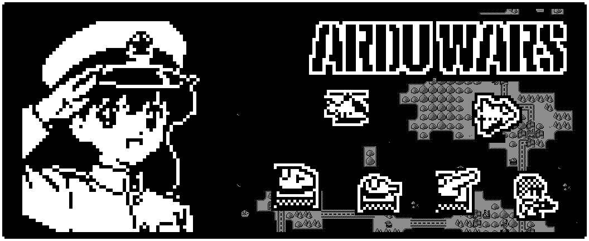

**Arduwars** is a turn-based strategy game for the [Arduboy](https://arduboy.com/). Build an army, capture cities and take the enemy headquarters. Play alone against the computer or with a friend on one Arduboy.

**[Download the latest version](https://github.com/BotiKis/Arduwars/releases/latest)**


### Game Features
* Single player against a computer enemy
* Two players on one Arduboy, passing it back and forth
* 3 maps: SKIRMISH, OPEN SEA and TWIN LAKES
* Capture buildings, earn money and buy new units
* Custom maps with the [Tiled map editor](https://www.mapeditor.org/)

---

### Story
There has been peace for many years in our lands until the evil forces of *Nextgenia* have invaded our country. Equipped with never before seen weapons their Army fearlessly takes over our lands.

*Cpt. Eidbit*, it is your mission to recover our lands and stop the great evil once for all. You are the commander of our army which you have lead to victory 🏁.

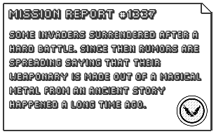

---

## How to play

Both armies start with a headquarters (HQ), one city and one factory. Every turn you move your units, fight and capture buildings, then you end your turn. You win when you capture the enemy HQ or destroy the enemy's last unit.

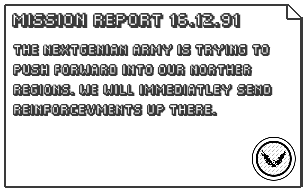

### Controls
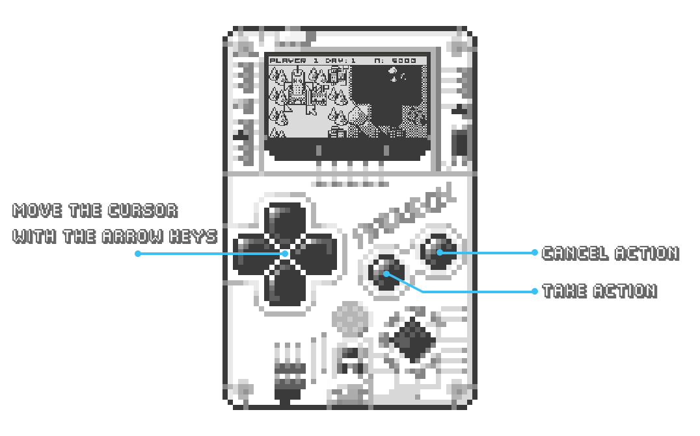

Button | On the map | In a menu
--|--|--
Arrows | Move the cursor | Move the selection
B | Select, walk, attack, open a shop or the turn menu | Confirm
Hold A | Move the cursor fast | -
Hold B | Snap the cursor onto the tile | -
A | Leave the attack targets and go back to the unit menu | Cancel

### Starting a match
The title shows **1 PLAYER**, **2 PLAYER** and **SOUND ON/OFF**. The sound setting is kept after you switch the Arduboy off. Then choose a map:

Map | Size | What is special
--|--|--
SKIRMISH | 12x12 | A small land map. Factories only.
OPEN SEA | 20x12 | Lots of water. Shipyards for ships.
TWIN LAKES | 25x7 | Two lakes between the bases. Airports for planes.

In **1 PLAYER** you lead player 1 against the computer. In **2 PLAYER** each player takes a turn on the same Arduboy. Between turns the screen goes black and shows whose turn it is, so nobody sees the other army. Press B when you have the Arduboy.

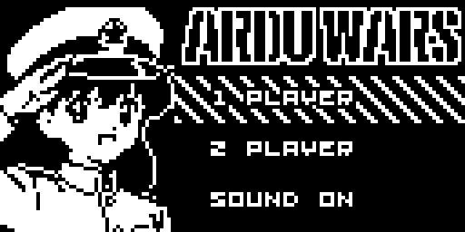

### The screen
The top bar shows the player (P1 or P2), the day (it starts at DAY:0), how many of your units can still act this turn out of all your units (01/04) and your money after **M:**.

Symbol | Meaning
--|--
![marker][marker-captured] | This building is yours.
![marker][marker-enemy] | This building belongs to the enemy.
![marker][marker-disabled] | This unit has already acted this turn. Ready units bob up and down.
![bar][marker-capture] | A capture is under way on this building. The black part is the capture points left.

* A number in a small box at the bottom right of a unit is its health. Full health is 10 and shows no number.
* Sandbags around a unit mean it is fortified.
* Fog covers what your units can not see. Enemy units in the fog are hidden, and so is who owns a building there.
* The HQs show no symbol. Each side has its own HQ picture.

### Moving
Put the cursor on one of your units and press B. The tiles it can reach light up. Move the cursor and an arrow shows the way. Press B to walk.

* You can walk through your own units, but you can not stop on them.
* Enemy units you can see block the way.
* An enemy hidden in the fog does not. If your unit walks into one, it stops in front of it and you see **AMBUSH**. After an ambush you can still attack, but you can not capture or cancel.
* Changed your mind before walking? Press B on the unit's own tile, then choose CANCEL.

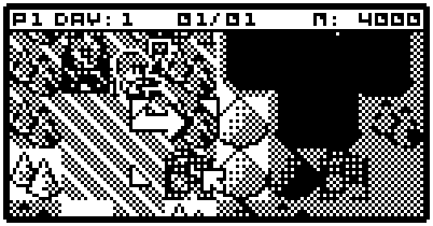

### The unit menu
After the walk a menu opens:

* **ATTACK**: only shows when an enemy is in range. Arrows jump between the targets, B fires, A goes back to the menu.
* **CAPTURE**: only for infantry on a building that is not yours.
* **WAIT**: the unit ends its turn.
* **FORTIFY**: shows instead of WAIT when a land unit did not move. It digs in behind sandbags for +2 defense. The sandbags stay until the unit walks away.
* **CANCEL**: walks the unit back. A does the same. CANCEL is gone after an ambush, or when the walk showed you new enemies.

### Fighting
Damage depends on the attacker's attack and health, and on the defender's defense, terrain cover and Fortify. Every hit rolls a little: 1 less, as expected or 1 more.

* **Direct units** (range 1) can move and attack in the same turn. The defender strikes back if it survives and can hit the attacker.
* **Indirect units** (range 2 and more) attack only when they did not move. They never get a strike back, and they never strike back.
* A hurt unit hits weaker.
* Not every unit can hit every target. See the units table below.

### Capturing
Only infantry can capture. Every building has 15 capture points, an HQ has 20. Each CAPTURE takes away as many points as the unit has health. A healthy soldier needs 2 turns, a hurt one needs more. A bar at the bottom of the building shows the points left. If the building is left empty before it is taken, the points go back to full. Capture the enemy HQ and you win at once.

### Money and the shop
Every city you own pays **2000** at the start of your turn. Put the cursor on your own factory, airport or shipyard with no unit on it and press B to open the shop. An **x** marks units you can not afford yet. A new unit can act from your next turn. Each army can have up to 24 units.

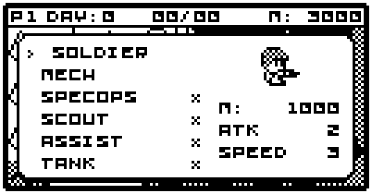

### Healing
At the start of your turn:
* A unit on your own building heals 2. Land units heal on any of your buildings, planes at an airport, ships at a shipyard.
* An Assist heals every own unit next to it by 1.

### Seeing
Every unit sees a few tiles around it. On a mountain or a building it sees 1 farther. Hills and mountains block the view behind them, and so do enemy units. Thick forest hides what is behind it. Your own buildings always show the 2 tiles around them.

### Ending your turn
Press B on an empty tile and choose **END TURN**. While units can still act, the menu shows how many are left, for example **1 LEFT**. Choose it to jump to the next one. After 255 days a match ends in a draw. When the match is over, the results screen shows the days, the units each side destroyed, the buildings held and the money left. Press B to go back to the title.

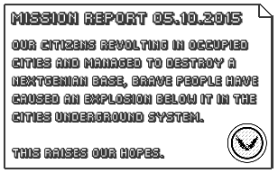

### Terrain
Cover is extra defense for a unit that stands there. Planes get no cover.

Sprite  |  Name   | Cover | Description
--|--|--|--
![terrain][terrain-plains]    |  Plains     | 0 | Open ground. Everyone but ships can go here.
![terrain][terrain-street]    |  Streets    | 0 | A unit that starts its turn on a street moves 1 tile farther.
![terrain][terrain-forrest]   |  Forests    | 1 | Leaving a forest costs 1 extra move. The view passes through 2 forest tiles, not more.
![terrain][terrain-hill]      |  Hills      | 2 | Leaving a hill costs 1 extra move. Hills block the view.
![terrain][terrain-mountain]  |  Mountains  | 3 | Only infantry and planes. After leaving a mountain a unit moves only 1 more tile. Units on a mountain see 1 farther.
![building][building-city]    |  Buildings  | 2 | No ships. Units on a building see 1 farther. The HQ gives cover 3.
![terrain][terrain-water]     |  Water      | 0 | Only ships and planes.
![terrain][terrain-reef]      |  Reefs      | 0 | Dangerous for ships: only planes can cross a reef.

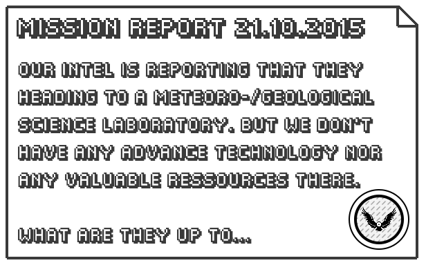

### Buildings

Sprite  |  Name   |  Description
--|--|--
![building][building-city]      |  Cities                   |   Cities are the foundation of a nation. Every city you own pays 2000 at the start of your turn.
![building][building-factory]   |  Factories                |   Build land units here.
![building][building-airport]   |  Airports                 |   Build planes here. Planes heal here.
![building][building-shipyard]  |  Shipyards                |   Build ships here. Ships heal here.
![building][building-hq1]       |  Players HQ               |   This is our Headquarters. Defend it by any means.
![building][building-hq2]       |  Nextgenias Headquarter   |   This are the Headquarters of the Nextgenians. If you can occupy this heavily fortified building you immediately win the battle.

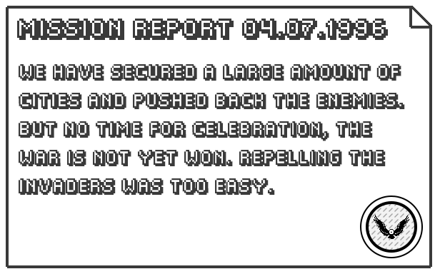

### Units
Sprite | Name | Hits | Description
--|--|--|--
![unit][unit-soldier] | Soldier | Land, Heli, sea | Basic infantry. Weak, but key for a win: only infantry can capture and climb mountains.
![unit][unit-mech] | Mech | Land, Heli, sea | Heavy infantry with good damage against armor.
![unit][unit-specops] | SpecOps | Land, sea | Fast and well trained special forces.
![unit][unit-scout] | Scout | Land, sea | A light vehicle with high mobility and a wide view.
![unit][unit-support] | Assist | Land, sea | Heals every own unit next to it by 1 at the start of your turn.
![unit][unit-tank] | Tank | Land, sea | Powerful armored vehicle with good mobility.
![unit][unit-bigtank] | BigTank | Land, sea | Heavy armor and the hardest hits on land. For desperate times.
![unit][unit-artillery] | Artillery | Land, sea | Fires from afar. Can not move and attack in the same turn.
![unit][unit-rocket] | Rocket | Air, sea | Long range anti-air and anti-ship. Can not move and attack in the same turn.
![unit][unit-missiles] | Missiles | Land, sea | Long range against the ground. Can not move and attack in the same turn.
![unit][unit-heli] | Heli | Land, air, sea | Basic air unit that can attack everything.
![unit][unit-fighter] | Fighter | Air | Fast and powerful, but only fights other planes.
![unit][unit-bomber] | Bomber | Land, air, sea | They call it **Fear of the Skies**.
![unit][unit-cruiser] | Cruiser | Air, sea | Guards the sea against planes and ships.
![unit][unit-battleship] | Battleship | Land, air, sea | One of our most powerful weapons, far out on the sea. Can not move and attack in the same turn.

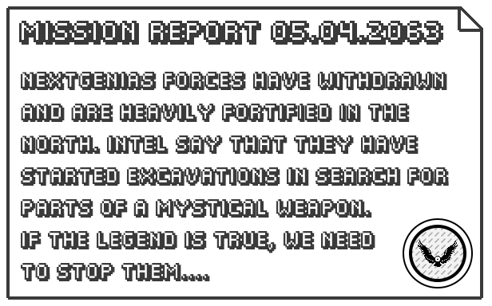

---

## Put Arduwars on your Arduboy
Download `Arduwars-1.1.hex` from the [releases page](https://github.com/BotiKis/Arduwars/releases/latest) and upload it with any Arduboy uploader. You can also play it in an Arduboy emulator like [Ardens](https://github.com/tiberiusbrown/Ardens).

### Hold DOWN to upload
Arduwars has no USB support. Leaving it out made room for more of the game. The catch: an uploader can no longer restart the Arduboy by itself. So once Arduwars is on your Arduboy, every new upload works like this, for Arduwars and for any other game:

1. Switch the Arduboy off.
2. Hold **DOWN** and switch it on. The screen stays dark.
3. Start the upload within a few seconds.

If an upload still does not start, hold **UP** while you switch the Arduboy on. This is the Arduboy's safe mode. It stops the game, and you can upload again.

## Building

Arduwars is an Arduino sketch: open `Arduwars/Arduwars.ino`. The Arduboy uses the same chip as the **Arduino Leonardo**, so build for that board.

You need:
* Arduino AVR Boards 1.8.8 (`arduino:avr`)
* [Arduboy2](https://github.com/MLXXXp/Arduboy2) 6.0.0
* The small container library in `Arduwars/lib/SimpleArduinoUtilitiesAlpha2`. Copy that folder into your Arduino `libraries` folder.

### Compiler settings
Arduwars needs nine settings of the compiler to fit on the Arduboy. They change how the program is packed, not what it does, and make it about 1,900 bytes smaller.
* `-mcall-prologues`: every function saves the chip's registers at its start and restores them at its end. This setting keeps one shared copy of that code instead of one in every function.
* `-mrelax`: uses the short form of jumps and calls wherever the target is close enough.
* `-mstrict-X`: uses one of the chip's address registers in a way that needs fewer instructions.
* `-fno-move-loop-invariants`, `-fno-tree-loop-optimize`, `-fno-tree-ter`, `-fno-tree-dominator-opts`, `-fno-tree-coalesce-vars`, `-fno-tree-ccp`: turn off speed tricks of the compiler that cost space. Arduwars stays as fast as before.

**arduino-cli**
```
arduino-cli compile --fqbn arduino:avr:leonardo \
  --library Arduwars/lib/SimpleArduinoUtilitiesAlpha2 \
  --build-property "compiler.c.extra_flags=-mcall-prologues -mrelax -mstrict-X -fno-move-loop-invariants -fno-tree-loop-optimize -fno-tree-ter -fno-tree-dominator-opts -fno-tree-coalesce-vars -fno-tree-ccp" \
  --build-property "compiler.cpp.extra_flags=-mcall-prologues -mrelax -mstrict-X -fno-move-loop-invariants -fno-tree-loop-optimize -fno-tree-ter -fno-tree-dominator-opts -fno-tree-coalesce-vars -fno-tree-ccp" \
  --build-property "compiler.c.elf.extra_flags=-mcall-prologues -mrelax -mstrict-X -fno-move-loop-invariants -fno-tree-loop-optimize -fno-tree-ter -fno-tree-dominator-opts -fno-tree-coalesce-vars -fno-tree-ccp" \
  Arduwars
```

**Arduino IDE**

The IDE has no per-sketch compiler settings. Create a file `platform.local.txt` next to the `platform.txt` of the Arduino AVR Boards package:
* macOS: `~/Library/Arduino15/packages/arduino/hardware/avr/1.8.8/`
* Windows: `%LOCALAPPDATA%\Arduino15\packages\arduino\hardware\avr\1.8.8\`
* Linux: `~/.arduino15/packages/arduino/hardware/avr/1.8.8/`

with these three lines:
```
compiler.c.extra_flags=-mcall-prologues -mrelax -mstrict-X -fno-move-loop-invariants -fno-tree-loop-optimize -fno-tree-ter -fno-tree-dominator-opts -fno-tree-coalesce-vars -fno-tree-ccp
compiler.cpp.extra_flags=-mcall-prologues -mrelax -mstrict-X -fno-move-loop-invariants -fno-tree-loop-optimize -fno-tree-ter -fno-tree-dominator-opts -fno-tree-coalesce-vars -fno-tree-ccp
compiler.c.elf.extra_flags=-mcall-prologues -mrelax -mstrict-X -fno-move-loop-invariants -fno-tree-loop-optimize -fno-tree-ter -fno-tree-dominator-opts -fno-tree-coalesce-vars -fno-tree-ccp
```
It must be plain text named exactly `platform.local.txt` (in TextEdit: Format > Make Plain Text). On macOS the `Library` folder is hidden: in Finder use Go > Go to Folder and paste the path. Or create the file from Terminal:
```
printf 'compiler.c.extra_flags=-mcall-prologues -mrelax -mstrict-X -fno-move-loop-invariants -fno-tree-loop-optimize -fno-tree-ter -fno-tree-dominator-opts -fno-tree-coalesce-vars -fno-tree-ccp\ncompiler.cpp.extra_flags=-mcall-prologues -mrelax -mstrict-X -fno-move-loop-invariants -fno-tree-loop-optimize -fno-tree-ter -fno-tree-dominator-opts -fno-tree-coalesce-vars -fno-tree-ccp\ncompiler.c.elf.extra_flags=-mcall-prologues -mrelax -mstrict-X -fno-move-loop-invariants -fno-tree-loop-optimize -fno-tree-ter -fno-tree-dominator-opts -fno-tree-coalesce-vars -fno-tree-ccp\n' > ~/Library/Arduino15/packages/arduino/hardware/avr/1.8.8/platform.local.txt
```

Then restart the IDE. The file applies to every sketch you build for Arduino AVR boards. Delete it to go back.

The IDE reuses files it compiled before and does not notice changed settings. After you add or remove `platform.local.txt`, quit the IDE and delete its build cache, or the size it shows mixes old and new settings:
* macOS: `~/Library/Caches/arduino/`
* Windows: `%LOCALAPPDATA%\arduino\`
* Linux: `~/.cache/arduino/`

With the settings the game uses 27,896 of 28,672 bytes. Without them it is about 1,150 bytes too big.

### Uploading
Hold **DOWN** while you switch the Arduboy on, then start the upload. See [Hold DOWN to upload](#hold-down-to-upload).

### Custom maps
Maps live in `Arduwars/MapData.h`. The file explains how to draw a map in [Tiled](https://www.mapeditor.org/) with `Assets/Gamesprites/worldSprite_16x16.png` and paste it in. A map can be up to 25x12 tiles with up to 24 buildings. The Tiled files of the 3 maps are in `Assets/MapData`.

## Credits
* **Boti**: director, designer, lead developer
* **Pharap** and **bitb4nger**: code. A huge thank you to both of you! Pharap cleaned up and improved the code. bitb4nger's pull request brought combat, capturing, the computer enemy and the animations, and finished the game.
* The title pinup is based on an AI illustration (Z-Image Turbo), pixel-cleaned by Boti.
* Built with the [Arduboy2](https://github.com/MLXXXp/Arduboy2) library.

## Do you like Arduwars?
Arduwars is free and should never be monetized.
Anyhow I would appreciate any little donation if you think this game was worth playing.

[](https://paypal.me/BotiKis)


[//]: # (image references here)
[marker-captured]: Assets/ReadmeAssets/marker-captured.png "marker-captured"
[marker-enemy]: Assets/ReadmeAssets/marker-enemy.png "marker-enemy"
[marker-disabled]: Assets/ReadmeAssets/marker-disabled.png "marker-disabled"
[marker-capture]: Assets/ReadmeAssets/marker-capture.png "marker-capture"

[terrain-forrest]: Assets/ReadmeAssets/terrainAndBuildings/terrain-forrest.png "terrain-forrest"
[terrain-hill]: Assets/ReadmeAssets/terrainAndBuildings/terrain-hill.png "terrain-hill"
[terrain-mountain]: Assets/ReadmeAssets/terrainAndBuildings/terrain-mountain.png "terrain-mountain"
[terrain-plains]: Assets/ReadmeAssets/terrainAndBuildings/terrain-plains.png "terrain-plains"
[terrain-reef]: Assets/ReadmeAssets/terrainAndBuildings/terrain-reef.png "terrain-reef"
[terrain-street]: Assets/ReadmeAssets/terrainAndBuildings/terrain-street.png "terrain-street"
[terrain-water]: Assets/ReadmeAssets/terrainAndBuildings/terrain-water.gif "terrain-water"

[building-airport]: Assets/ReadmeAssets/terrainAndBuildings/building-airport.png "building-airport"
[building-city]: Assets/ReadmeAssets/terrainAndBuildings/building-city.png "building-city"
[building-factory]: Assets/ReadmeAssets/terrainAndBuildings/building-factory.png "building-factory"
[building-hq1]: Assets/ReadmeAssets/terrainAndBuildings/building-headquarter1.png "building-hq1"
[building-hq2]: Assets/ReadmeAssets/terrainAndBuildings/building-headquarter2.png "building-hq2"
[building-shipyard]: Assets/ReadmeAssets/terrainAndBuildings/building-shipyard.png "building-shipyard"


[//]: # (Unit image references here)
[unit-artillery]: Assets/ReadmeAssets/unitgifs/unit-artillery.gif "unit-artillery"
[unit-battleship]: Assets/ReadmeAssets/unitgifs/unit-battleship.gif "unit-battleship"
[unit-bigtank]: Assets/ReadmeAssets/unitgifs/unit-bigtank.gif "unit-bigtank"
[unit-bomber]: Assets/ReadmeAssets/unitgifs/unit-bomber.gif "unit-bomber"
[unit-cruiser]: Assets/ReadmeAssets/unitgifs/unit-cruiser.gif "unit-cruiser"
[unit-fighter]: Assets/ReadmeAssets/unitgifs/unit-fighter.gif "unit-fighter"
[unit-heli]: Assets/ReadmeAssets/unitgifs/unit-heli.gif "unit-heli"
[unit-mech]: Assets/ReadmeAssets/unitgifs/unit-mech.gif "unit-mech"
[unit-missiles]: Assets/ReadmeAssets/unitgifs/unit-missiles.gif "unit-missiles"
[unit-rocket]: Assets/ReadmeAssets/unitgifs/unit-rocket.gif "unit-rocket"
[unit-scout]: Assets/ReadmeAssets/unitgifs/unit-scout.gif "unit-scout"
[unit-soldier]: Assets/ReadmeAssets/unitgifs/unit-soldier.gif "unit-soldier"
[unit-specops]: Assets/ReadmeAssets/unitgifs/unit-specops.gif "unit-specops"
[unit-support]: Assets/ReadmeAssets/unitgifs/unit-support.gif "unit-support"
[unit-tank]: Assets/ReadmeAssets/unitgifs/unit-tank.gif "unit-tank"
